# squadwrap — Spotify Wrapped for your friend group, built from what friends submit

## Live

**https://squadwrap.1426davejobs.workers.dev**

squadwrap runs on a Cloudflare Worker (Workers Paid) since 2026-11-08; Vercel's deployment answers 402. These screenshots were taken against the live Worker with Chrome for Testing by `node scripts/screenshots-live.mjs`. That made a real group, "Flat 4B": three friends answered through the API and Eli in the browser. Gemini wrote the awards, and the Worker drew the slide. The group is deleted after 30 days, like every group.

| | Desktop (1440×900) | Phone (iPhone 13) |
|---|---|---|
| The start page | 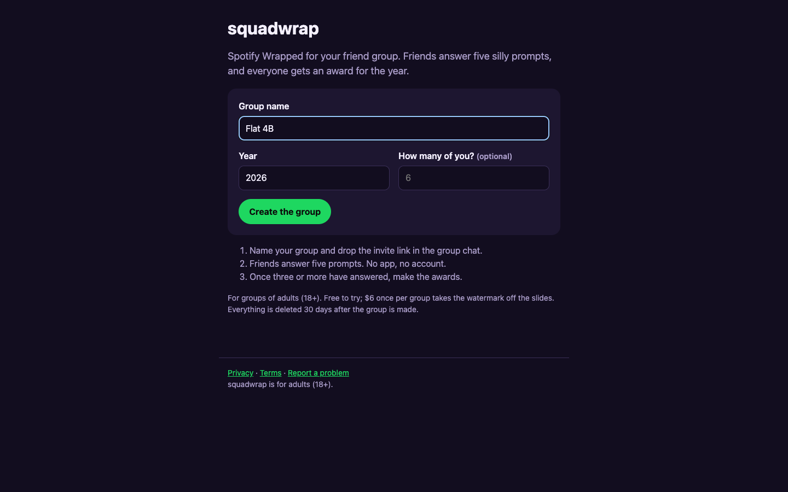 | 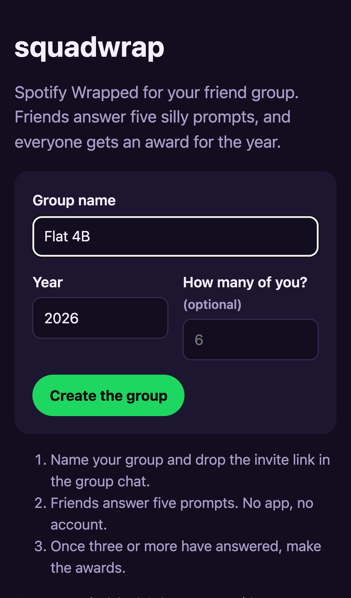 |
| A friend answering through the invite link, photo added, 18+ box ticked | 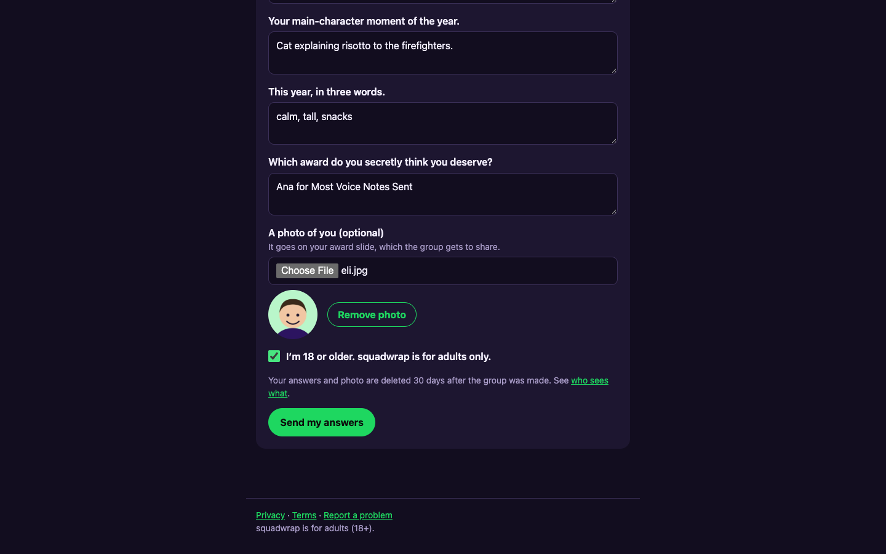 | 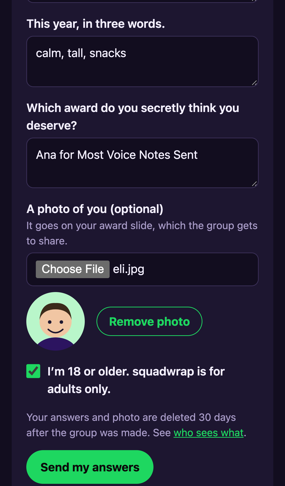 |
| The organizer's awards from Gemini, with the $6 Buy button (Stripe test-mode Payment Link) | 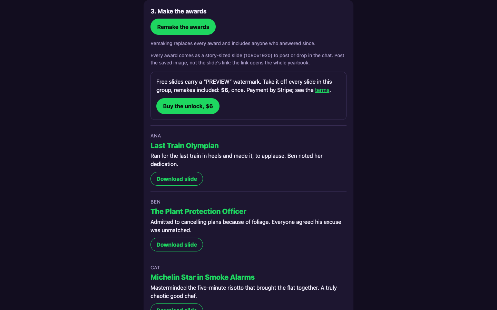 | 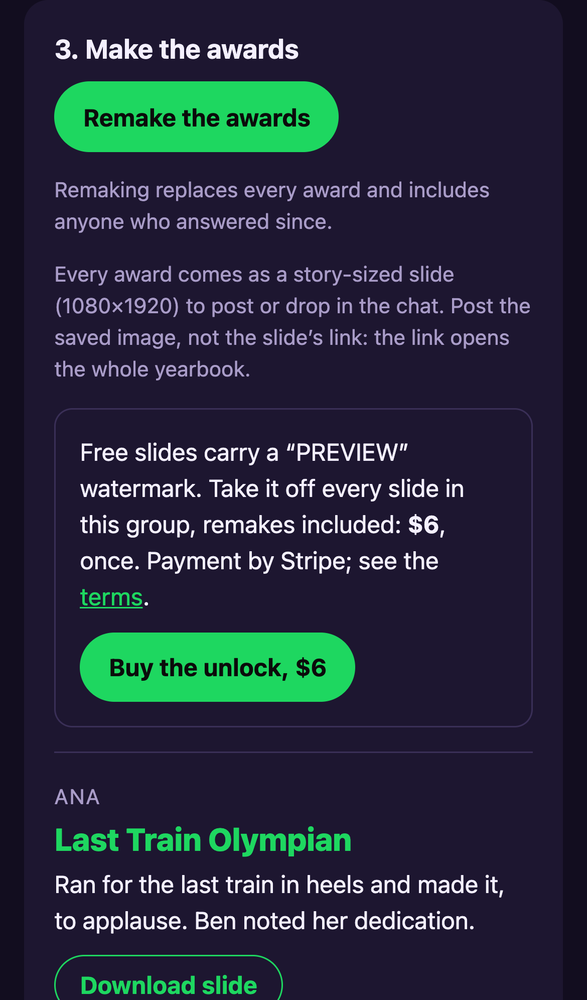 |
| One award as the 1080×1920 story slide the Worker draws (watermarked until the group is unlocked) | 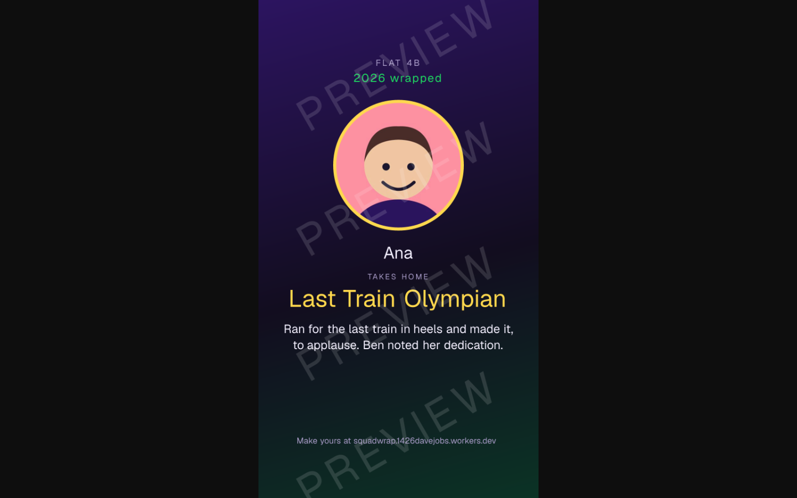 | 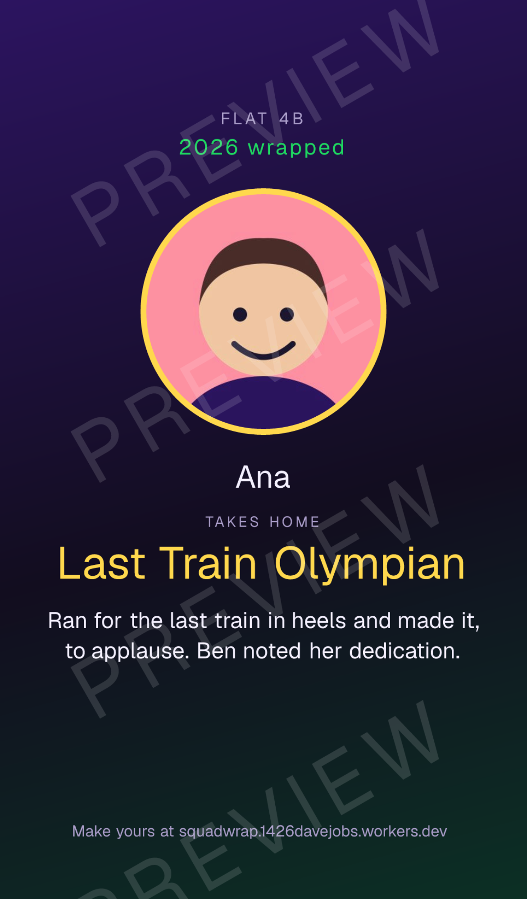 |

## Payment, tested live

`npm run payment:live` ran the whole purchase on https://squadwrap.vercel.app with Stripe in test mode (2026-10-13, before the move to the Worker): three friends answer, the organizer makes the awards and clicks Buy, pays $6 on Stripe's checkout with the test card 4242 4242 4242 4242, and the webhook unlocks the group. It passes at desktop and phone size.

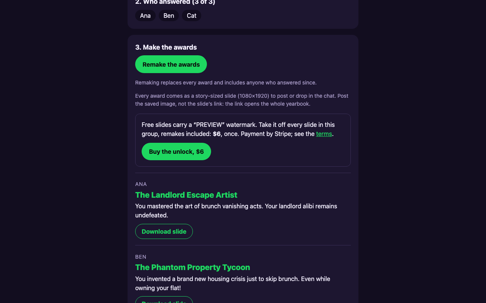
The organizer's awards on the live site, with the Buy button (the Stripe Payment Link with the group attached).

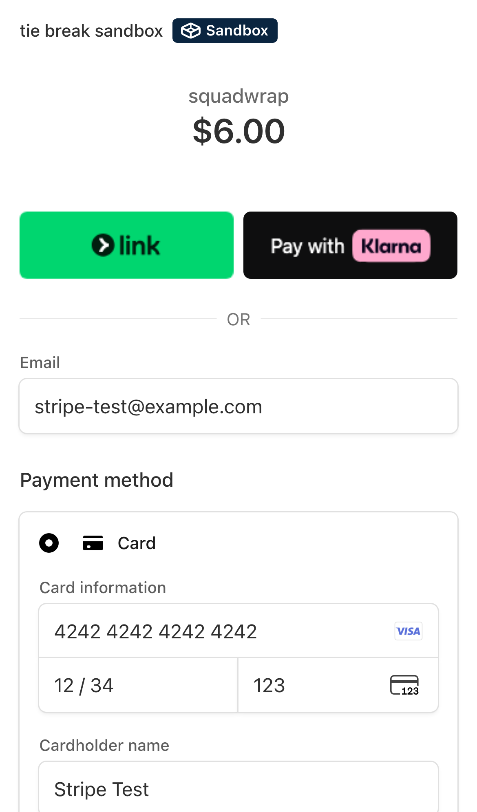
Stripe's hosted checkout on a phone, in test mode, with the test card.

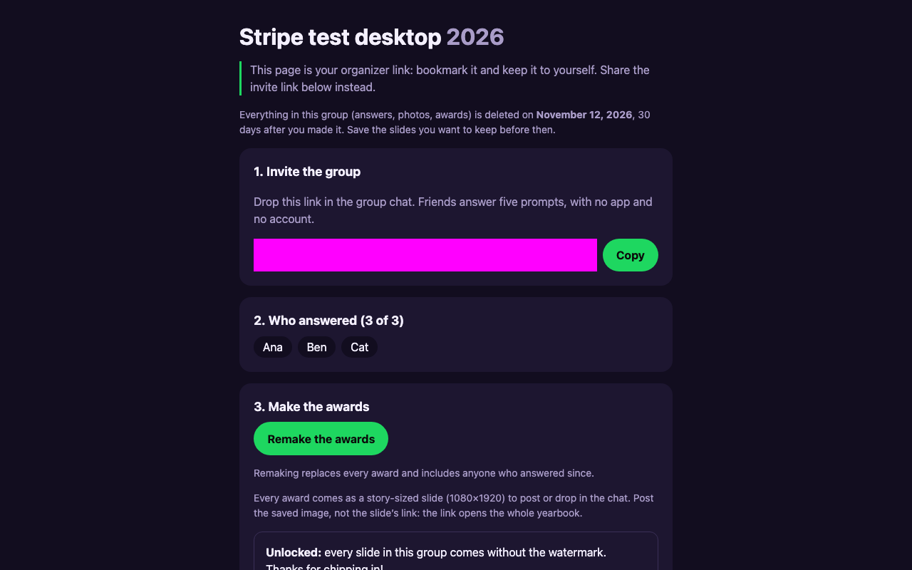
Back on the organizer page: "Unlocked", set by the webhook once Stripe confirmed the payment.

## Screenshots

Captured by `npm run screenshots` from the production build (`next start`) in Chromium, with sample friends, drawn avatars, a stub AI model and a placeholder payment link. The same run checks the titles, canonical URLs, share tags, JSON-LD, robots.txt and sitemap.xml over HTTP.

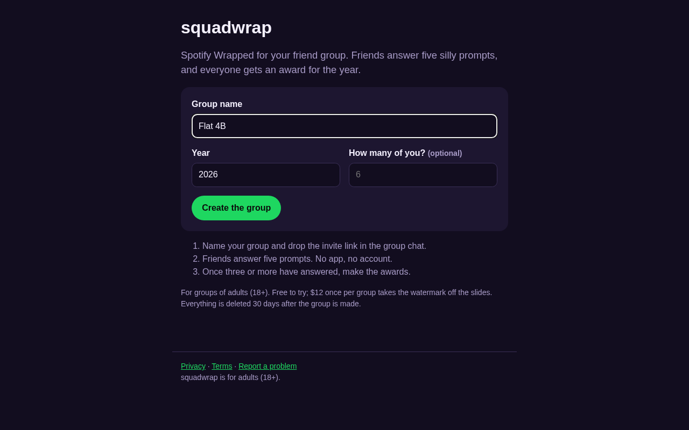
The start page: name the group, see the $6 price, and the footer links privacy, terms and takedowns on every page.

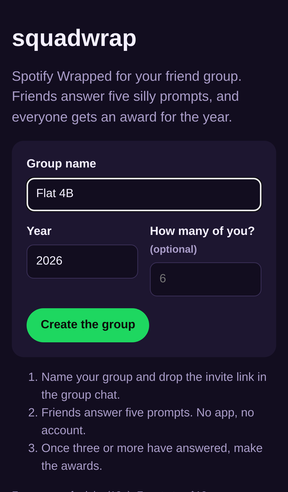
The same start page on an iPhone 13.

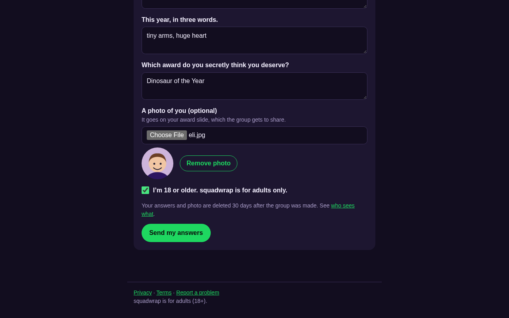
A friend answers through the invite link: prompts filled in, photo shrunk in the browser, the required "I'm 18 or older" box ticked, and the 30-day deletion stated.

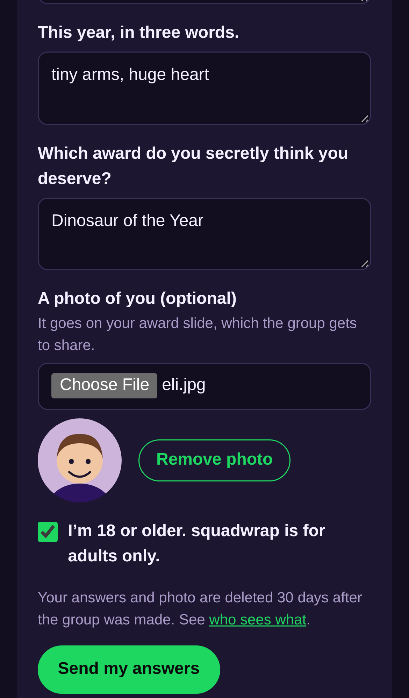
The same friend form on a phone.

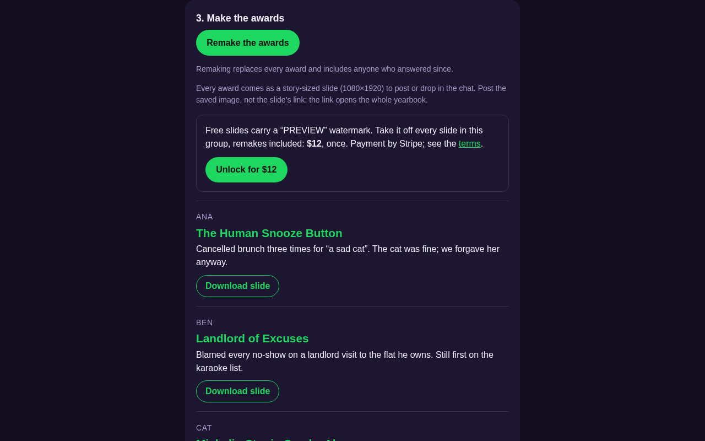
The result: one AI award per friend with its slide download, and the Buy button (the Stripe payment link, $6 once) that removes the watermark.

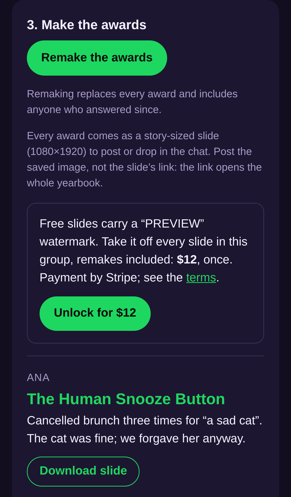
The same awards and Buy button on a phone.

For the organizer of a friend group, roommates or a team, it turns a few funny answers from each friend into one story-format award slide per person and a group yearbook page, with no chat export and no app install.

- [Research](RESEARCH.md) — findings and sources
- [PRD](PRD.md)
- [Roadmap](ROADMAP.md)
- [Launch readiness](LAUNCH-READY.md): what's set up for a public launch, and what's left
- [Revenue plan](REVENUE.md)

Effort: Low · Confidence: Low

_Researched by the idea pipeline on 2026-10-13 ([original record](https://github.com/smithdavedesign/idea-factory/tree/main/ideas/squadwrap)); repo created on David's go-ahead 2026-10-13._
