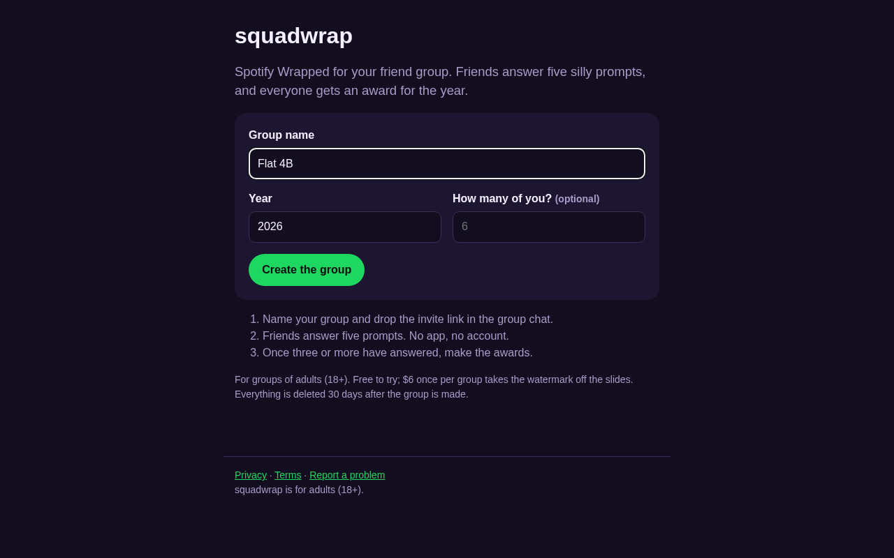
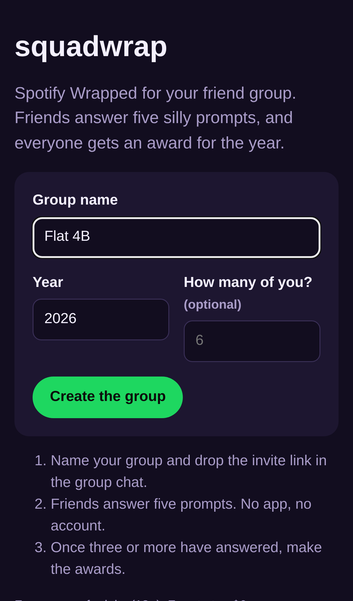
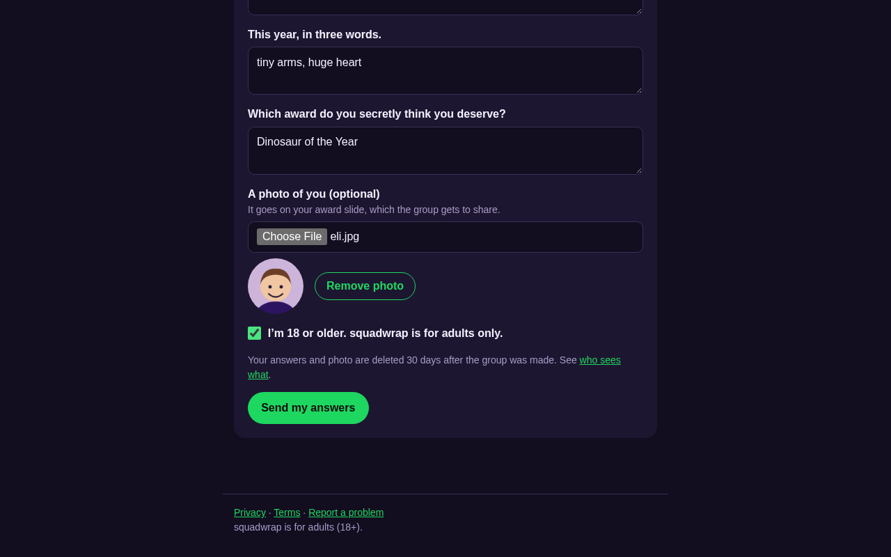
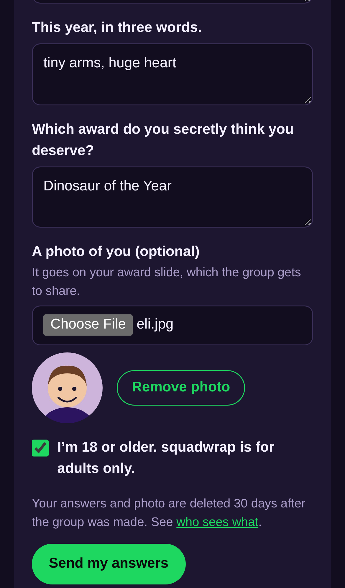
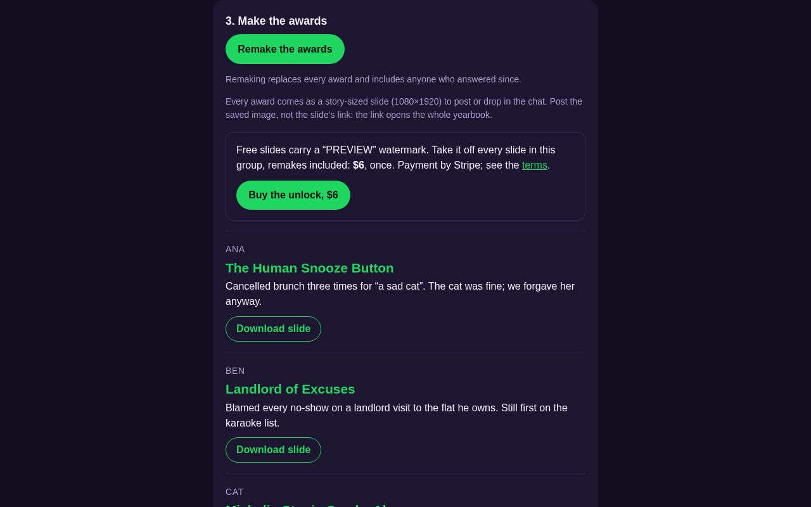
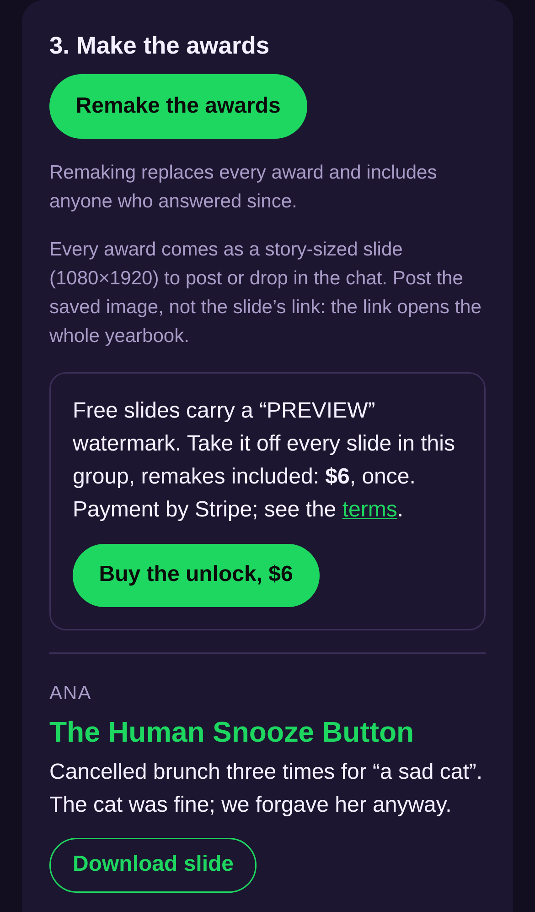

# squadwrap — Spotify Wrapped for your friend group, built from what friends submit

## Screenshots

Captured by `npm run screenshots` from the production build (`next start`) in Chromium, with sample friends, drawn avatars, a stub AI model and a placeholder payment link. The same run checks the titles, canonical URLs, share tags, JSON-LD, robots.txt and sitemap.xml over HTTP.

The start page: name the group, see the $6 price, and the footer links privacy, terms and takedowns on every page.

The same start page on an iPhone 13.

A friend answers through the invite link: prompts filled in, photo shrunk in the browser, the required "I'm 18 or older" box ticked, and the 30-day deletion stated.

The same friend form on a phone.

The result: one AI award per friend with its slide download, and the Buy button (the Stripe payment link, $6 once) that removes the watermark.

The same awards and Buy button on a phone.

For the organizer of a friend group, roommates or a team, it turns a few funny answers from each friend into one story-format award slide per person and a group yearbook page, with no chat export and no app install.

- [Research](RESEARCH.md) — findings and sources
- [PRD](PRD.md)
- [Roadmap](ROADMAP.md)
- [Launch readiness](LAUNCH-READY.md): what's set up for a public launch, and what's left
- [Revenue plan](REVENUE.md)

Effort: Low · Confidence: Low

_Researched by the idea pipeline on 2026-10-13 ([original record](https://github.com/smithdavedesign/idea-factory/tree/main/ideas/squadwrap)); repo created on David's go-ahead 2026-10-13._
